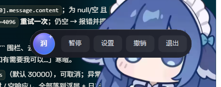
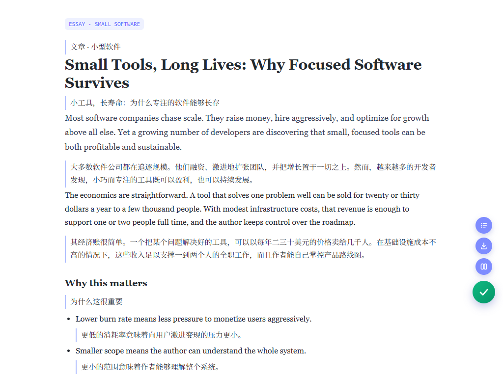
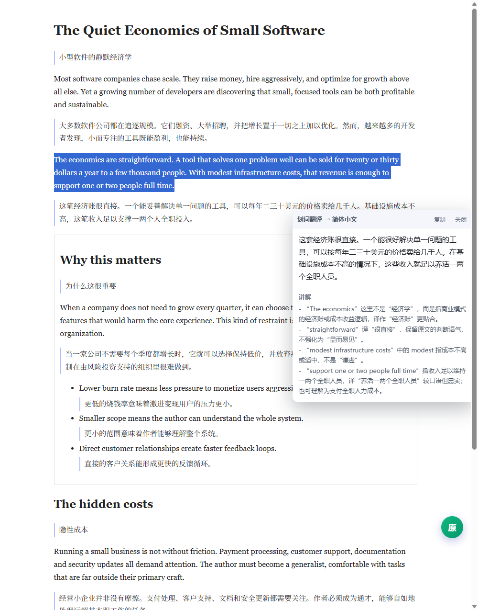
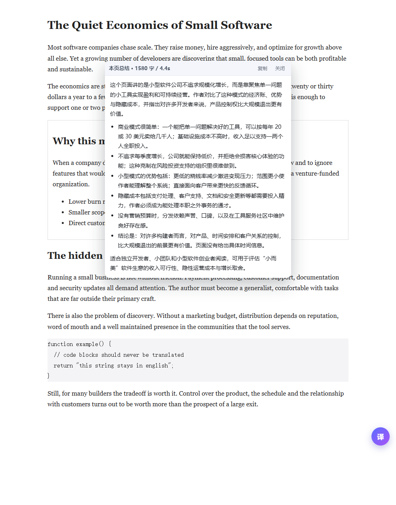
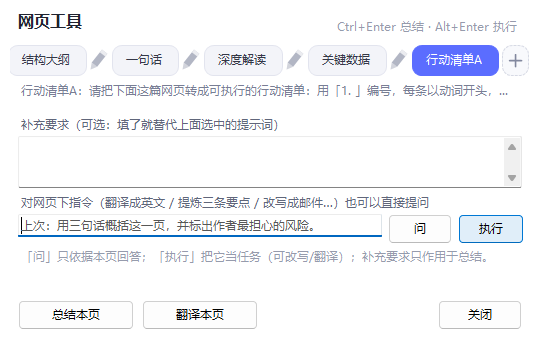
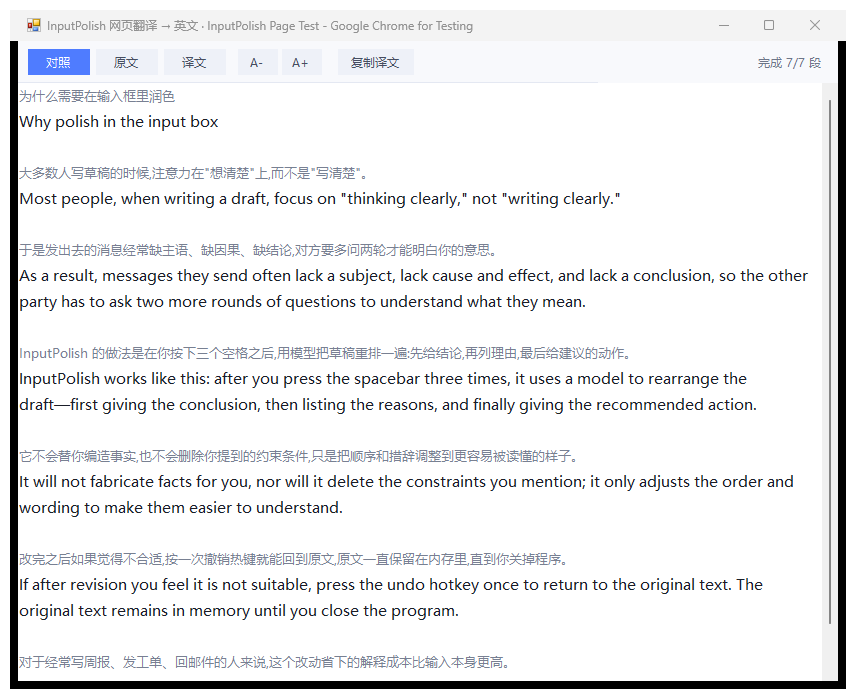

# InputPolish

> 在**任何**软件、**任何**网页的输入框里敲三下空格，AI 帮你把草稿理顺写回去。原意不变，只改表达。
>
> 顺带还会：**网页内划词翻译**（选中就冒小胶囊，点一下在网页里出卡片）、**网页内整页双语对照**（点悬浮球「译页」或热键，译文直接插在原文下面）、**网页内整页总结**（Ctrl+反引号 弹提示词面板，总结卡片直接开在网页里）。

<p align="center">
  
</p>

<p align="center">
  
  
</p>

<p align="center">
  
  
  
</p>

<p align="center">
  
  
</p>

- 交付物：`dist\InputPolish.exe`（单文件，.NET Framework 4.8，无需安装运行时）+ `ext\`（浏览器扩展，网页内翻译/总结用，装一次永久有效）
- 网页内功能不需要另填任何 Key：扩展只跟本机 `127.0.0.1` 的 InputPolish 通信，模型调用仍由 exe 用你已配置的后端完成
- 配置/日志：`%APPDATA%\InputPolish\`（`config.json`、`log.txt`、`last-result.txt`）
- 语言/依赖：C# 5 + WinForms + UIAutomation，**零第三方依赖**；除 AI 接口外不发任何网络请求
- 平台：Windows 10 / 11（x64 / ARM64，anycpu）

---

## 一、开始使用

1. 双击 `InputPolish.exe`。右下角出现一个蓝色渐变圆球，上面写着「润」。
2. 打开任意软件或网页，点进一个**可编辑的输入框**，写一段草稿，例如：
   ```
   这个方案有点问题主要是成本太高而且交付周期长
   ```
3. 连续敲 **三下空格**（间隔 600ms 内）。
4. 圆球变橙（处理中）→ 2~6 秒后变绿，输入框内容被替换成：
   ```
   这个方案有点问题，主要是成本太高，而且交付周期长。
   ```
   屏幕提示「已优化 · 2.5s · Ctrl+Alt+Z 撤销」。
5. 如果改得不满意，按 **Ctrl+Alt+Z** 一键还原。

三下空格本身不会留在输入框里（会被撤回）。

> 想用网页内翻译 / 划词 / 总结，再做一步：见下面的「三·一〇、装浏览器扩展」（约 30 秒，装完自动配对，不用填任何 Key）。

---

## 二、触发方式一览

| 功能 | 默认操作 | 说明 |
| --- | --- | --- |
| 润色当前输入框 | 连敲**三下空格** | 主力方式，所有软件通用，可在设置里改成 2~6 下 |
| 润色当前输入框 | **Ctrl+Alt+L** | 不方便连按空格时用（全屏、远程桌面） |
| 撤销润色 | **Ctrl+Alt+Z** | 10 分钟内有效，会自动把原窗口切回前台再改 |
| 划词翻译 | 选中文字后**自动冒出浮标**，点浮标即可 | 不想用浮标就按 **Ctrl+Alt+T**（或把浮标关掉） |
| 网页翻译 | **Ctrl+Alt+W** 或悬浮球「译页」 | 装了扩展：译文**直接插进网页**（原文下方双语对照）；没装：弹出中英对照阅读窗 |
| 网页总结 | **Ctrl+反引号** 或悬浮球「总结」 | 弹提示词面板，一键总结；面板里也能翻译整页 |
| 还原网页 | 悬浮球「译页」再点一次 / 托盘菜单「还原网页为原文」 | 删掉所有插入的译文，恢复原网页 |
| 全部功能 | 悬浮球 / 托盘右键菜单 | 「立即润色」「撤销」「翻译选中文字」「翻译整个网页」「还原网页为原文」「总结当前网页」「快捷面板」「润色风格」 |

热键都能在设置里改；被别的程序占用时会在启动日志里写明「注册失败」并提示。

---

## 三、桌面悬浮球

始终置顶，鼠标移上去自动横向展开：

```
[ 暂停 / 启用 ] [ 译页 ] [ 总结 ] [ 设置 ] [ 撤销 ] [ 退出 ]
```

- **单击**圆球：钉住（展开后不会自动收起）；再单击取消钉住
- **左键拖动**：换位置（位置会记住）
- **双击**：打开设置
- **右键**：完整菜单（含「打开日志」「打开配置目录」「开机自启」「退出」）
- 圆球颜色 = 状态：蓝紫待命 / 橙色转圈处理中 / 绿色成功 / 红色出错 / 灰色斜杠已暂停

不想要悬浮球：设置里取消「显示桌面悬浮框」，或托盘菜单同名项。功能不受影响，托盘图标仍在。

---

## 三·五、三种润色风格

托盘菜单「润色风格」或设置里的下拉框切换，配置项 `polishStyle`：

| 风格 | 效果（同一句草稿「这个方案有点问题主要是成本太高而且交付周期长」） |
| --- | --- |
| **默认润色** | 这个方案有点问题，主要有两点：一是成本太高，二是交付周期长。 |
| **更简短** | 这个方案有点问题：成本太高、交付周期长。 |
| **更正式** | 该方案存在一定问题，主要是成本过高且交付周期较长。 |
| **翻译成英文** | This proposal has some issues: the cost is too high, and the delivery lead time is long. |

三种中文风格共用同一套「不改原意」硬规则（不新增事实、不删信息、只调顺序与措辞），叠加各自的目标；「翻译成英文」换成专门的翻译提示词，保留专有名词、代码、数字与单位。

---

## 三·六、划词翻译（Ctrl+Alt+T）

1. 在任意程序里**用鼠标选中**一段文字（网页、PDF、聊天记录、代码都行）。
2. 按 **Ctrl+Alt+T**。
3. 光标旁边弹出一张卡片：顶部是「划词翻译 → 简体中文」+「复制」「✕」，中间译文，底部灰色「讲解」（术语、语气、易错点）。

要点：

- **不抢焦点**：弹窗是 `WS_EX_NOACTIVATE | TOPMOST`，弹出时你的光标还在原来的输入框里，可以继续打字。
- **目标语言**：默认「自动识别」——中文内容译成英文，其它译成简体中文；也能在设置里固定成「简体中文」或「英文」。
- **讲解可关**：设置里取消「翻译附带讲解」，只保留译文，更快。
- 读取选区的顺序是 UIA TextPattern → 剪贴板兜底（Ctrl+C）。剪贴板兜底会先比对剪贴板序号，**如果 Ctrl+C 没真的复制到新内容就不再读剪贴板**——避免把上一次留在剪贴板里的旧文字当成选区翻译掉。

---

## 三·七、网页翻译（Ctrl+Alt+W / 悬浮球「译页」）

**装了扩展（推荐）**：译文直接插在网页里，原文下方一行灰色…不，是一行带蓝紫竖线的中文，**页面本身**就是双语对照，不用另开窗口。

1. 在网页上按 **Ctrl+Alt+W**，或点悬浮球「译页」。
2. 右下角悬浮球旁边冒一行提示「已在网页内开始双语翻译」，网页里的「译」小圆球开始转。
3. 译文按段落**逐段插进 DOM**，边译边出现（160 段的 GitHub 页面约 60 秒译完）。
4. 再按一次同一个热键 / 再点一次「译页」→ 全部译文被删掉，网页恢复原样。

细节：
- **跳过代码**：`script` / `style` / `code` / `pre` / `textarea` / `input` / `svg` 一律不译，代码块保持原样。
- **表格与列表**：`td` / `th` / `li` / `dd` / `figcaption` 这类容器把译文**塞进**容器内部，不会把表格撑散。
- **自动跳过已是目标语言的段落**：译成中文时中文段落原样保留，省 token 也更好读。
- **翻译后新加载的内容会自动补译**：MutationObserver 盯着 DOM，无限滚动、切 tab 出来的新段落会被追加翻译（每轮最多 12 段）。
- **并发与批量**：每批 6 段、并发 3~4 路，失败段落单独重试，不会因为一段超时整页失败。

**没装扩展**：回退到外部阅读窗，功能一样全：

```
[对照] [原文] [译文]  [A-] [A+] [复制译文]                     完成 7/7 段
────────────────────────────────────────────────────────────
Why you need polishing in the input box            ← 标题（不翻译时会保留原文）
大多数人写草稿的时候，注意力在"想清楚"上而不是"写清楚"。      ← 灰色：原文
Most people, when writing a draft, focus on ...    ← 黑色：译文
```

- **对照 / 原文 / 译文** 三种显示模式一键切换；`A-` `A+` 调字号；「复制译文」把整页译文复制成纯文本。
- 段落是**逐段流式回填**的：读完正文立刻开窗，译文一段一段自己长出来，不用干等。
- 正文通过 UI Automation `TextPattern` 读取，取不到时退回窗口标题并给出提示。
- 段落数与字数上限在设置里（默认 40000 字 / 160 段），超长网页只译前 N 段。

---

## 三·八、划词浮标（选中就冒，点一下就译）

1. 在任意程序里**用鼠标拖选**一段文字。
2. 松手的瞬间，选区右下方冒出一个蓝紫小胶囊：**「译 划词翻译」**。
3. 点它就译，译文卡片仍然**不抢焦点**；3.5 秒不点会自动消失（鼠标悬停在上面时暂停倒计时）。

细节：

- **只在真有选区时出现**：用 UIA TextPattern 读当前选区，读不到或选区为空就什么都不弹。
- **不拦鼠标**：浮标是 `WS_EX_NOACTIVATE | TOPMOST`，不会让原来的选区消失，也不会打断打字。
- **点完不会反复冒**：点掉之后 1.5 秒内的鼠标抬起事件直接忽略，不会刚关又弹。
- 点浮标时用的是**已经读好的那段文字**，不会再去读一次选区（有些程序在你点别处时选区就没了）。
- 不想要：设置里取消「划词浮标」，划词翻译仍可用 Ctrl+Alt+T。
- **浏览器里装了扩展时，桌面浮标会自动让位**：改由网页里的浮标负责，两个浮标不会叠在一起。

---

## 三·八·五、网页内划词翻译（扩展）

装好扩展后，在网页上拖选文字，选区右下角会冒出一个**网页内**的小胶囊「译 划词翻译」：

- 点它 → 一张卡片直接在页面里展开（不是另开窗口，也不抢焦点）：标题「划词翻译 → 简体中文」，中间译文，底部灰色「讲解」（术语、语气、易错点）。
- 卡片**跟随网页滚动**，`Esc` 或点空白处关闭；「复制」一键复制译文。
- 快捷键 **Alt+S**：翻译当前选区（不想点浮标时用）。
- 桌面端 Ctrl+Alt+T 在浏览器里会**转交给扩展**执行（日志里能看到 `in-page dispatch command=selection`），所以弹出的也是网页内卡片。

---

## 三·八·六、网页内总结（Ctrl+反引号 / 悬浮球「总结」）

同上一个面板触发，只是走扩展时结果直接开在网页里：

- 一张 470px 的**宽卡片**居中偏上展开，标题「本页总结 · N 字 / X 秒」。
- 正文是**富文本**渲染的：小标题、项目符号、编号列表、**加粗**、行内代码都会正常排版（不是一坨纯文本）。
- 面板里改过的提示词会**一起送到扩展**（日志 `http summary uses pending prompt len=128`），模型用的就是你现场改的那份。
- 「复制」按钮复制总结正文；「关闭」或 Esc 收起。
- 已经翻译成双语的页面**总结的是原文**（不会把插入的译文当正文）—— 页面翻译过之后仍然能正常总结。

---

## 三·九、网页总结 + Ctrl+反引号 快捷面板

按 **Ctrl+反引号** 或点悬浮球「总结」，会弹出一个小面板：

```
网页总结 / 翻译                                  ×
┌────────────────────────────────────────────┐
│ 请总结下面这个网页的主要内容，要求：                 │ ← 默认提示词，可以现场改
│ 1. 先用一两句话说明这个页面在讲什么；                 │
│ 2. 再用 3-6 条要点列出关键信息（含数字、结论、时间）；    │
│ 3. 最后给出一句「适合谁看 / 有什么用」的建议；          │
│ 4. 全部用中文，不要编造页面里没有的内容。              │
└────────────────────────────────────────────┘
Ctrl+Enter 总结本页   ·   Ctrl+反引号 打开本面板
[ 总结本页 ]  [ 翻译本页 ]  [ 关闭 ]
```

- **总结本页**（或面板里 Ctrl+Enter）：读当前网页正文 → 模型总结 → 弹出总结窗（可改提示词后「重新总结」、A-/A+、复制、保存）。
- **翻译本页**：等价于 Ctrl+Alt+W，弹出双语对照阅读窗。
- **读哪个窗口**：按 Z 顺序挑最上层的「非本程序」窗口，优先浏览器（Tabbit / Chrome / Edge / Firefox / Electron …）。所以面板自己浮在最上面也**不会**把面板自己的文字当网页来总结。
- **长网页**：正文超过 5000 字会先分块提炼要点（最多 6 块），再把要点合成一篇总结，末尾标注「共 N 字 · 用时 Ns · N 次模型调用」。

---

### 图标

整个视觉是同一套：紫蓝渐变圆角方块 + 白色「润」字 + 右上角四角星（代表 AI），悬浮球、托盘图标、exe 图标、设置窗口标题栏图标全部同源。

- 图标源文件：[assets/icon.ico](assets/icon.ico)（16/20/24/32/40/48/64/128/256 九个尺寸；≤48px 用 32 位 BMP 条目，大尺寸用 PNG 条目）
- 导出脚本：[tools/make-icon.py](tools/make-icon.py)（Python + Pillow，超采样 4× 后 LANCZOS 缩放；小尺寸自动去掉四角星避免糊成一团）
- 想换配色：改脚本顶部的 `A`（左上紫）/ `B`（右下蓝），跑 `python tools/make-icon.py` 重新生成全部 PNG + ICO，再 `build.cmd` 即可

---

## 三·一〇、装浏览器扩展（只装一次，约 30 秒）

网页内翻译 / 划词 / 总结都靠这个扩展。不装也能用，只是回到「另开窗口」的老形态。

1. 右键托盘图标 → **「安装浏览器扩展…」**（会打开 `ext\` 文件夹并弹出这四步说明）；或者：双击悬浮球打开设置 →「网页内翻译」组 → 点 **「打开扩展目录」**。
2. 浏览器地址栏进扩展管理页：`chrome://extensions`（Chrome / Edge / Tabbit 都一样）。
3. 右上角打开 **开发者模式** → 点 **「加载已解压的扩展程序」**。弹出的选择框里直接按 **Ctrl+L** 再 **Ctrl+V**（
   「安装浏览器扩展…」已经把 `ext` 的完整路径复制到剪贴板了），回车即可。

   > ⚠️ 要选的是 **`ext` 这一层**（打开后能直接看见 `manifest.json`、`ip-bg.js`）。
   > 如果选成它的上一层（`input-polish`），Chrome 会报 **「清单文件缺失或不可读取 / 无法加载清单」**——那就是选错层了，返回上一级点进 `ext` 再选一次。
4. 装好后**什么都不用填**：InputPolish 每次启动都会把端口和连接码写进 `ext\_pair.json`，扩展开机启动时读这个文件自动配对。
5. 回到设置窗口，「扩展状态」会变成绿色的「已连接（N 秒前有心跳）」。

没自动连上怎么办：
- 点扩展图标 →「设置」→ 点 **「自动连接」** 按钮。
- 还不行就把设置窗口里那串 **连接码** 复制，粘到扩展选项页的输入框里保存。
- 确认 InputPolish 正在运行，且设置里「启用网页内翻译」是勾上的（默认勾上）。

安全边界：
- 扩展**只**访问 `http://127.0.0.1:<端口>`，不连任何外网。
- 所有本机接口都要 `X-IP-Token` 头，连接码是 56 位随机十六进制，存在 `%APPDATA%\InputPolish\config.json`。
- `_pair.json` 只有本机文件权限和扩展自己能读（`chrome-extension://<id>/_pair.json`），网页读不到也伪造不出。
- 接口只绑定回环地址，同一局域网的其他机器连不上。

---

## 四、设置项（双击圆球 / 右键菜单「设置…」）

### AI 后端与请求参数
| 项 | 默认 | 说明 |
| --- | --- | --- |
| 接口地址 | `http://127.0.0.1:3425/v1` | 任何 OpenAI 兼容的 `/chat/completions` 端点 |
| API Key | 空 | 本机网关免鉴权；用云端服务时填 |
| 模型 | `auto/deepseek-v4.1-flash` | 点「拉取模型列表」可换成网关里的任意模型 |
| 温度 | 0.20 | 越低越稳定，润色建议 0~0.3 |
| 最大 tokens | 2000 | 太小时推理模型可能返回空内容（程序会自动加倍重试一次） |
| 超时 | 30000 ms | 长文本 + 推理模型需要留足时间 |
| 字数上限 | 2000 | 超过就直接拒绝，避免把整篇网页正文拿去润色 |
| 提示毫秒 | 2500 | 屏幕提示停留时间 |
| 剪贴板兜底 | 开 | UIA 读不到时用 Ctrl+A/Ctrl+C 兜底 |

「测试连接」验证地址与模型列表；「测试润色」用固定短句跑一次完整链路。

### 触发方式
连击空格开关 / 连击次数 / 间隔毫秒 / 润色热键 / 撤销热键 / 开机自启 / 显示桌面悬浮框。

### 润色风格与翻译
| 项 | 默认 | 说明 |
| --- | --- | --- |
| 润色风格 | 默认润色 | 默认 / 更简短 / 更正式 / 翻译成英文 |
| 翻译目标 | 自动识别 | 自动（中→英、其它→简中）/ 简体中文 / 英文 |
| 划词热键 | Ctrl+Alt+T | 选中文字后按；格式如 `Ctrl+Alt+T`、`Ctrl+Shift+F2` |
| 网页热键 | Ctrl+Alt+W | 翻译当前网页正文 |
| 翻译附带讲解 | 开 | 关掉后只返回译文，更快更省 token |
| 划词浮标 | 开 | 选中文字后自动冒「译」按钮；关掉则只能用 Ctrl+Alt+T |
| 浮标驻留 | 3500 ms | 浮标多久没被点就自动消失（悬停时暂停计时） |
| 面板热键 | Ctrl+反引号 | 打开「总结 / 翻译」快捷面板 |
| 页面字数上限 | 40000 | 网页翻译 / 总结最多读多少字符 |
| 段落上限 | 160 | 网页翻译最多译多少段 |

### 排除进程
逗号分隔的进程名，默认排除终端与密码管理器：
```
WindowsTerminal,conhost,KeePass,KeePassXC,1Password,Bitwarden
```
在这些程序里三连空格不触发，避免干扰 shell 与误改密码框。

### 网页内翻译（浏览器扩展）
| 项 | 默认 | 说明 |
| --- | --- | --- |
| 启用网页内翻译 | 开 | 关掉后不再监听本机端口，扩展也连不上（桌面功能不受影响） |
| 端口 | 8790 | 本机回环端口；被占用时改成 8791 等，保存后扩展会自动重连 |
| 连接码 | 自动生成 | 56 位随机十六进制，扩展用它调用本机接口；「复制」按钮一键复制 |
| 扩展状态 | — | 每 1.2 秒刷新：已连接 / 未连接 / 已断开 / 已关闭，带上次心跳时间 |

同组按钮：「复制」连接码、「打开扩展目录」（装扩展 / 查看 `_pair.json`）。

### 网页总结提示词

Ctrl+反引号 面板里预填的那段提示词。它只影响「总结」，面板里可以临时改；改完想长期生效就回设置里保存。装了扩展时这段提示词会随命令一起送到网页内使用。

### 系统提示词
决定「怎么改」。默认六条硬规则：不改原意 / 保持原语言与专有名词 / 结构优先（分点、分段、加标点）/ 只输出正文 / 已清晰则最小改动 / 语种一致。想让它更保守或更激进，直接改这里。

---

## 五、兼容性与已知限制

**已验证可用**
- WinForms / Win32 `Edit` 控件（记事本、旧式对话框）—— 润色走 `WM_SETTEXT`，不依赖焦点
- Chromium 系浏览器网页输入框（Chrome / Edge / Tabbit / Electron 应用，走 UIA ValuePattern）
- 支持 UIA TextPattern 的富文本控件
- 拿不到 UIA 时的剪贴板兜底路径（Ctrl+A / Ctrl+C / Ctrl+V）
- 网页正文读取（Chromium 的 `ControlType.Document` + TextPattern）
- 划词翻译的三种取词路径（TextPattern / TextPattern.DocumentRange / 剪贴板兜底）
- **网页内双语对照 / 划词卡片 / 总结卡片**（Tabbit / Chromium 系实测：12 段测试页、160 段 GitHub 页面 0 失败）
- **扩展自动配对**（`ext/_pair.json`，装完即用，无需手填连接码）

**会明确拒绝**
- 只读区域（网页正文、地址栏）→ 提示「当前焦点是只读区域…请点进可编辑的输入框再试」，不调用模型
- 密码框 → 直接拒绝
- 排除名单里的进程 → 不触发
- 内容超过字数上限 → 提示提高上限或只润色选中片段
- 目标输入框已失去焦点 → **绝不往别的窗口打字**，直接取消

**注意**
- AI 生成需要联网（或本机网关在线）；断网时提示失败并保留原文。
- 处理中是串行的：上一次没结束，新的触发会被忽略。
- 写回失败时结果会保存到 `%APPDATA%\InputPolish\last-result.txt`，可手工粘贴。
- **网页内功能需要浏览器扩展**：没装扩展时自动回退到外部窗口/弹窗，功能不减但形态不同。
- **扩展只支持顶层页面**（`all_frames: false`）：iframe 里的正文不会被翻译。
- **PDF / 阅读模式 / 跨域 iframe 页面**：扩展注入不到，建议用外部对照窗（Ctrl+Alt+W）。

---

## 六、维护

| 事项 | 做法 |
| --- | --- |
| 看日志 | 托盘菜单「打开日志」，或 `%APPDATA%\InputPolish\log.txt`（1MB 自动轮转） |
| 改配置 | 托盘菜单「打开配置目录」→ `config.json`（GUI 设置更稳） |
| 自检 | `InputPolish.exe --selftest`，报告写到 `%APPDATA%\InputPolish\selftest.txt` |
| 关开机自启 | 设置里取消「开机自启」，或托盘菜单同名项；注册表值 `HKCU\Software\Microsoft\Windows\CurrentVersion\Run` → `InputPolish` |
| 卸载 | 关掉「开机自启」→ 退出程序 → 删掉 exe 与 `%APPDATA%\InputPolish` |

命令行参数：`--selftest`（自检）、`--polish`（立刻润色）、`--undo`（撤销）、`--settings`（打开设置）。重复启动时参数会转发给已运行的实例，不会开第二个。

IPC 命令（命名管道 `InputPolish_cmd_7F3A21`）：`polish` / `undo` / `settings` / `translate` / `page` / `restore` / `summary` / `panel` / `style` / `style=<id>` / `summary=<提示词>` / `menu`。`tests\ipcsend.exe <命令>` 是最方便的触发方式。

浏览器扩展用的本机接口：`GET /health`、`GET /poll`（长轮询取命令）、`POST /translate`、`POST /selection`、`POST /summary`、`POST /command`、`GET /pair`（扩展自动配对，只接受 extension origin）。全部要 `X-IP-Token`，只绑回环。

---

## 七、从源码重新构建

需要 .NET Framework 4.8 自带的 `csc.exe`（Windows 10/11 自带，无需装 SDK）：

```
cd input-polish
build.cmd
```

产物 `dist\InputPolish.exe`（图标已通过 `/win32icon` 嵌入，并同时作为嵌入资源供托盘使用）。

### 目录结构

```
input-polish/
├── src/                     33 个 .cs —— 全部逻辑，C# 5 语法
│   ├── Program.cs           入口 / 命令行 / 单实例转发
│   ├── TrayApp.cs           托盘、主窗口、IPC 服务端
│   ├── FloatWidget.cs       桌面置顶悬浮球（自绘 + 动画）
│   ├── Engine.cs            触发 → 读 → 润色 → 写 → 撤销 的流水线
│   ├── UiaIo.cs             UIA / Win32 / 剪贴板三层读写与校验
│   ├── Native.cs            所有 P/Invoke
│   ├── KeyHook.cs           全局键盘钩子（三连空格判定）
│   ├── HotkeyWindow.cs      RegisterHotKey 消息窗口
│   ├── SettingsForm.cs      设置窗口
│   ├── Polisher.cs          OpenAI 兼容调用 + 输出清洗（润色管线）
│   ├── Styles.cs            四种润色风格 → system prompt
│   ├── Translate.cs         划词/整页翻译调用与译文切分
│   ├── SelectionReader.cs   读取当前选区（TextPattern → 剪贴板兜底）
│   ├── PageReader.cs        用 TextPattern 读整页正文并切段
│   ├── PopupCard.cs         划词翻译卡片（不抢焦点，未装扩展时用）
│   ├── ReadPane.cs          网页双语阅读窗（未装扩展时用）
│   ├── Summary.cs           网页总结（分块提炼 + 合并，桌面与扩展共用）
│   ├── SummaryPane.cs       总结结果窗（可改提示词重算、A-/A+、保存）
│   ├── QuickPanel.cs        Ctrl+反引号 快捷面板（总结 / 翻译）
│   ├── HttpApi.cs           本机回环 HTTP 接口（扩展的翻译/总结/命令通道）
│   ├── SelectionBubble.cs   划词浮标
│   ├── SelectionWatcher.cs  鼠标抬起 → 判断选区 → 弹浮标
│   └── ...
├── ext/                     浏览器扩展（MV3，无需构建，直接「加载已解压的扩展程序」）
│   ├── manifest.json        权限：storage + 127.0.0.1 主机权限
│   ├── ip-bg.js             service worker：长轮询收桌面命令、转发到活动标签
│   ├── content.js           网页内注入：双语对照、划词卡片、总结卡片、悬浮球
│   ├── popup.html/js        工具栏弹窗：翻译本页 / 还原 / 设置
│   ├── options.html/js      扩展选项：自动连接、端口、目标语言、字号
│   ├── icons/               16/32/48/128 图标
│   └── _pair.json           本机自动配对的端口与连接码（运行时生成，已 gitignore）
├── assets/
│   ├── icon.ico             多尺寸图标（构建时嵌入）
│   ├── icon-*.png           各尺寸 PNG
│   └── screenshots/         README 用截图
├── tools/make-icon.py       图标生成脚本
├── tests/                   自动化验证脚手架（.cs 源码 + 本地编译的 .exe）
├── build.cmd                csc 构建脚本
├── app.manifest             高 DPI + asInvoker 清单
└── README.md
```

源码在 `src\`（**C# 5 语法**，因为 csc 4.8 不支持插值字符串与 `?.`）。`tests\` 下是自动化验证工具（三连空格注入、浏览器场景、设置窗口点击、菜单点击、截图等）。

> ⚠️ `tests\run-test.cmd` 会设置 `INPUTPOLISH_ACCEPT_INJECTED=1` 后启动程序，让键盘钩子接受 SendInput 注入的空格键——**仅供自动化测试**。日常使用请直接双击 `dist\InputPolish.exe`，否则模拟按键也会触发润色。

---

## 八、许可

[MIT](LICENSE)。自用、改、分发都随意。
